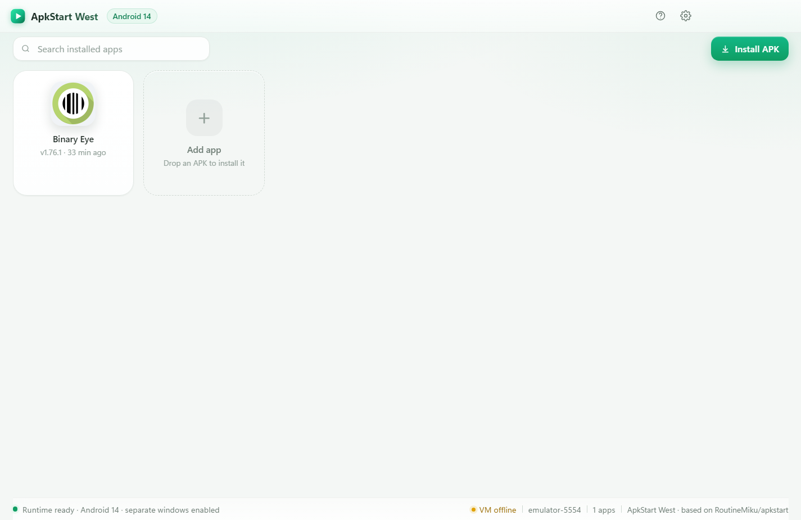
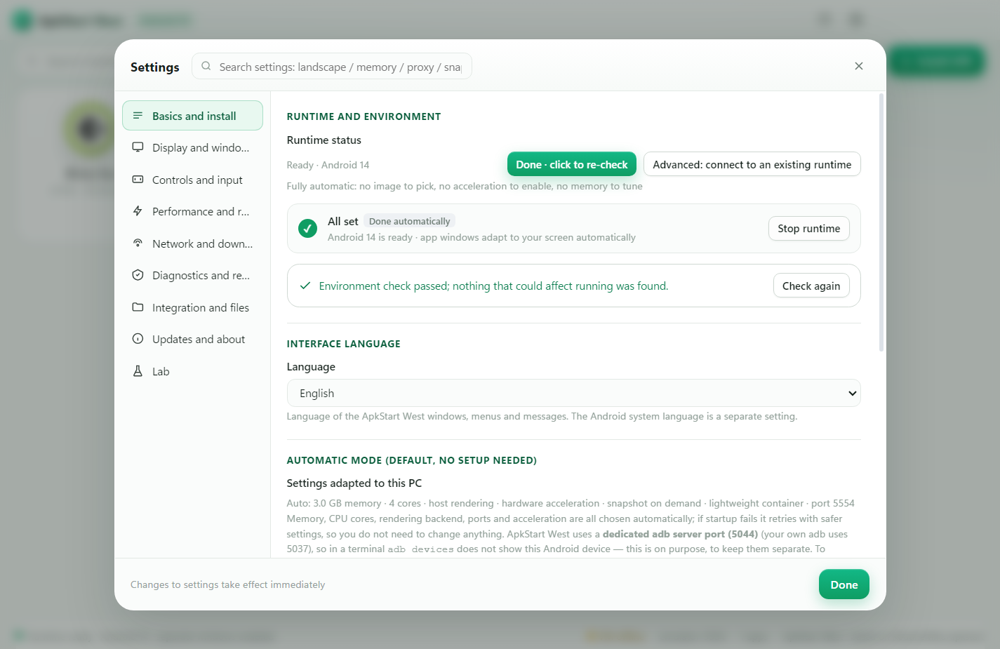

# ApkStart West

<p align="center"></p>

[](https://github.com/mvoloch/apkstart-west/actions/workflows/ci.yml)
[](LICENSE)
[](#requirements)

**Run Android apps on Windows like native programs, with no connection to servers in China.**

*[Português abaixo](#português)*

ApkStart West is a fork of [ApkStart](https://github.com/RoutineMiku/apkstart) by RoutineMiku (MIT). It keeps everything that makes ApkStart useful and removes every path to a server in China:

- **Double-click an .apk to install it.** ApkStart parses the APK, installs it into its own Android runtime and creates a desktop and Start menu shortcut with the app's real icon.
- **Each app is its own window**, sized for portrait or landscape, with its own taskbar entry.
- **Google Play works.** The runtime is Google's official Android Emulator with the Android 14 Google Play system image, downloaded from `dl.google.com`.
- **Shared folder.** `%USERPROFILE%\ApkStartShared` on the PC syncs with `/sdcard/ApkStartShared` in Android.
- **English or Portuguese interface** (Settings → Basics and install → Interface language). Android itself starts in English (changeable) and uses the PC's time zone.

<p align="center"></p>
<p align="center"></p>

## What changed from upstream

| Upstream ApkStart | ApkStart West |
|---|---|
| Downloads and updates through a code host in China and two third-party GitHub proxies | GitHub only; an optional mirror prefix is used only if you type one |
| Android DNS forced to two public DNS servers in China | Android uses your PC's DNS |
| Connectivity check pointed at a Chinese phone maker's server | Android's default Google check (connectivitycheck.gstatic.com) |
| Android in Chinese, China time zone, Pinyin keyboard on | Android in English, PC time zone, Chinese keyboard optional and off |
| Updater could replace the app with upstream releases | Updater only looks at `mvoloch/apkstart-west`; separate data folder (`%APPDATA%\apkstart-west`), install id and taskbar identity, so it never touches an upstream install |
| WeChat / Douyin QR codes and links, Microsoft Store package of upstream | Removed |

The full audit, naming every removed host and DNS server, with every host the code can reach and the traffic recorded in real runs (Android packet capture and Windows connection log), is in [docs/NO-CHINA.md](docs/NO-CHINA.md). A test (`test/no-china-test.js`, the first step of `npm test`) fails if any of the removed hosts or DNS servers comes back.

## Requirements

- Windows 10 or 11, x64, with virtualization enabled in the BIOS (Intel VT-x / AMD-V).
- Hardware acceleration: Windows "Virtual Machine Platform" (WHPX) or Google's AEHD driver. ApkStart West checks this and guides you.
- About 6 GB free disk space for the runtime and Android data.

## Download

Get `ApkStart-<version>-Setup.exe` from [Releases](https://github.com/mvoloch/apkstart-west/releases) (about 82 MB) and run it. It installs for your Windows user only, in `%LOCALAPPDATA%\Programs\ApkStart West`, with no administrator rights, and adds an "ApkStart West" shortcut to the desktop and the Start menu. It never touches an install of upstream ApkStart.

**Windows warning.** The installer is not code-signed (a signing certificate costs money every year), so Windows SmartScreen may show "Windows protected your PC". Click **More info**, check that the file name is right, then click **Run anyway**.

**Check the file (optional).** Each release has a `SHA256SUMS.txt` file with the fingerprint of every file. In PowerShell, in the folder where you saved the installer:

```powershell
Get-FileHash .\ApkStart-0.7.0-Setup.exe -Algorithm SHA256
```

The `Hash` it prints must match the line for that file in `SHA256SUMS.txt` (upper or lower case does not matter). If it does not match, do not run the file.

**Uninstall** from Windows Settings → Apps → Installed apps → ApkStart West. It stops Android if it is running and removes the program and its shortcuts. Your Android data (`%APPDATA%\apkstart-west`, a few GB) is kept so a reinstall starts fast; delete that folder by hand to free the space.

On first start the app downloads the Android runtime from Google (`dl.google.com`): platform-tools (~8 MB), Android Emulator (~460 MB) and the Android 14 Google Play system image (~1.5 GB). Nothing is downloaded from anywhere else unless you set a custom address in Settings.

## Build from source

```powershell
git clone https://github.com/mvoloch/apkstart-west.git
cd apkstart-west
npm ci
npm start              # opens the app; first run deploys the runtime from dl.google.com
npm test               # unit and integration tests, no network needed
npm run pack           # portable build in dist\ApkStart-win64-portable\
npm run build:exe      # installer in dist\release\ (app and Electron only, no Android runtime)
```

Node.js 20 or newer. With npm 11, if `node_modules\electron\dist\electron.exe` is missing after `npm ci`, run `node node_modules\electron\install.js`.

## Command line

```
ApkStart.exe                      open the main window
ApkStart.exe <path\to\app.apk>    install an APK
ApkStart.exe --launch <package>   start an installed app (used by the shortcuts)
```

## Credits and license

ApkStart West is based on [ApkStart](https://github.com/RoutineMiku/apkstart) by **RoutineMiku**, released under the MIT license; all the hard work on the runtime, windows, shortcuts and APK parsing is theirs. The upstream README (Chinese) is kept in [docs/upstream-README.zh-CN.md](docs/upstream-README.zh-CN.md). Developer docs in `docs/` come from upstream and are in Chinese.

[MIT](LICENSE). Releases contain only this app and Electron. The Android Emulator, system images and other Google components are downloaded by the user from Google and follow Google's licenses.

---

## Português

**Rode apps Android no Windows como programas nativos, sem nenhuma conexão com servidores na China.**

O ApkStart West é um fork do [ApkStart](https://github.com/RoutineMiku/apkstart), de RoutineMiku (licença MIT). Ele mantém o que o ApkStart tem de útil e remove todo caminho para servidores na China:

- **Dois cliques num .apk instalam o app**, com atalho na área de trabalho e no menu Iniciar usando o ícone do próprio app.
- **Cada app abre na sua própria janela**, com entrada própria na barra de tarefas.
- **A Google Play funciona.** O runtime é o emulador oficial do Android, do Google, com a imagem Android 14 com Google Play, baixada de `dl.google.com`.
- **Pasta compartilhada** entre o PC (`%USERPROFILE%\ApkStartShared`) e o Android (`/sdcard/ApkStartShared`).
- **Interface em inglês ou português** (Configurações → Básico e instalação → Idioma da interface). O Android começa em inglês (dá para mudar) e usa o fuso horário do PC.

O que mudou em relação ao original: saem o servidor de código na China e os dois proxies de terceiros do GitHub; sai o DNS chinês forçado e o Android passa a usar o DNS do seu PC; a verificação de conexão volta para a do Google, em vez da de um fabricante chinês; o Android deixa de vir em chinês com fuso da China; o atualizador só olha para `mvoloch/apkstart-west` e o app usa pasta de dados e identidade próprias, então nunca troca nem mexe numa instalação do ApkStart original. A auditoria completa, com o tráfego registrado em execuções reais, está em [docs/NO-CHINA.md](docs/NO-CHINA.md).

**Requisitos:** Windows 10 ou 11 de 64 bits, virtualização ligada na BIOS, uns 6 GB livres.

**Download.** Baixe `ApkStart-<versão>-Setup.exe` em [Releases](https://github.com/mvoloch/apkstart-west/releases) (uns 82 MB) e abra. Ele instala só para o seu usuário do Windows, em `%LOCALAPPDATA%\Programs\ApkStart West`, sem pedir senha de administrador, e cria o atalho "ApkStart West" na área de trabalho e no menu Iniciar. Não mexe numa instalação do ApkStart original.

**Aviso do Windows.** O instalador não tem assinatura digital (o certificado é pago todo ano), então o Windows pode mostrar "O Windows protegeu o computador". Clique em **Mais informações**, confira o nome do arquivo e clique em **Executar assim mesmo**.

**Conferir o arquivo (opcional).** Cada versão traz um arquivo `SHA256SUMS.txt` com a "impressão digital" (hash SHA-256) de cada arquivo. No PowerShell, na pasta onde salvou o instalador:

```powershell
Get-FileHash .\ApkStart-0.7.0-Setup.exe -Algorithm SHA256
```

O `Hash` que aparece tem de ser igual ao da linha desse arquivo no `SHA256SUMS.txt` (maiúscula ou minúscula tanto faz). Se for diferente, não abra o arquivo.

**Desinstalar:** Configurações do Windows → Aplicativos → Aplicativos instalados → ApkStart West. Ele desliga o Android se estiver aberto e remove o programa e os atalhos. Os dados do Android (`%APPDATA%\apkstart-west`, alguns GB) ficam, para uma reinstalação começar rápido; apague essa pasta à mão se quiser liberar o espaço.

Na primeira execução o app baixa do Google (`dl.google.com`) o emulador (~460 MB), a imagem do sistema (~1,5 GB) e as ferramentas adb (~8 MB). Para compilar a partir do código, use os comandos da seção "Build from source" acima.

**Créditos:** baseado no ApkStart, de **RoutineMiku**, sob licença MIT. Licença deste fork: [MIT](LICENSE).
